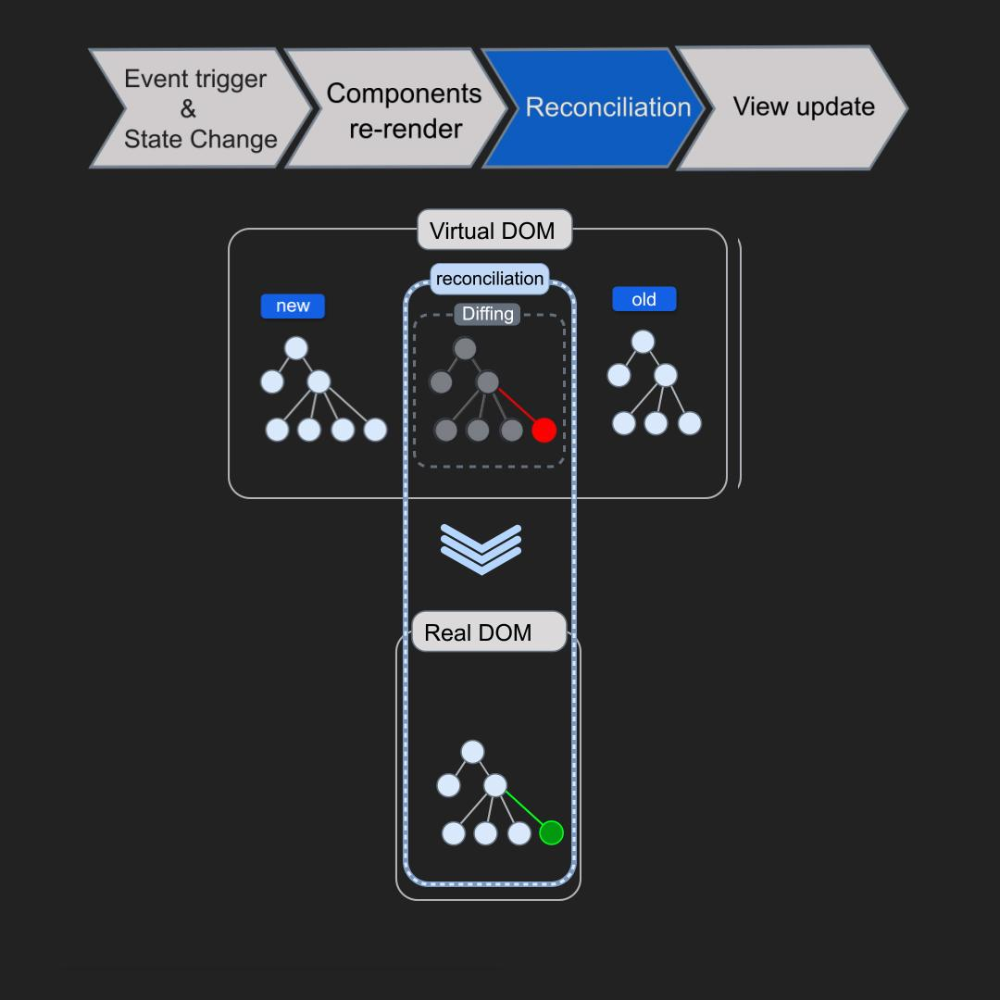

##  Virtual DOM vs Real DOM

###  Real DOM - Actual Web Page

-  **Real DOM** is  what you see in the **browser**
-  It is the real **HTML structure**
-  When something changes :
```
     whole page  `updates` and this is **slow**
```

#### Example:
 
- If you change one button text:
- Browser may **re-check** and **update** many elements


### Virtual DOM (Copy of Real DOM)

 Virtual DOM is **lightweight copy of the real DOM**  Used by React

 - Stored in memory (not visible)

-  Faster to update

-  Only updates what changed


### diagram



